# Indoor Office Object Detection Coursework Project

## 1. Project Overview

This project focuses on developing a computer vision system that detects and identifies office items in images or live camera feed. It uses the **YOLO11n** object detection model from Ultralytics to locate and classify objects belonging to the following seven classes:

- Bottle
- Scissors
- Laptop
- Smartphone
- Mug
- Bin
- Mouse

The system is developed with the aim of supporting an autonomous indoor office robot by enabling it to detect and locate these objects in its environment.

The project includes a Streamlit web application that allows users to upload images, capture images or use a live camera feed for object detection. The application then displays the detection results, including the predicted class, confidence score and  bounding box for each detected object.

## 2. Application Features

- **Image Upload:** Allow users to upload an image for object detection.
- **Live Camera:** Enables real-time object detection using the live camera feed.
- **Take picture from camera:** Allow users to capture a still image from the camera and run the object detection model on the captured image.
- **Object Detection:** Uses the trained YOLO11n model to detect and locate objects belonging to the seven predefined classes.
- **Detection Results:** Displays the predicted class, bounding box and confidence score for detected objects.
- **Model Performance Popup:** Displays the model performance metrics in a popup window.

## 3. Folder Structure

```text
.
├── .streamlit/
│   └── config.toml
│
├── assets/  
│
├── dataset/  
│   ├── own_images/
│   │   
│   ├── processed/
│   │   
│   ├── data.yaml
│   │   
│   └── DATASET_CARD.md
│
├── experiment/  
│
├── model/  
│
├── notebook/
│   └── model_training_tuning.ipynb
│
├── preview_with_bounding_boxes/
│
├── requirements.txt
│
├── runs/
│
├── src/
│   ├── breaking.py
│   │   
│   ├── checks.py
│   │   
│   ├── evaluate_own_images.py
│   │   
│   ├── inspect_annotations.py
│   │   
│   ├── preprocessing.py
│   │   
│   ├── test.py
│   │   
│   └── train.py
│
├── ui/
│   ├── config.py
│   │   
│   └── styles.py
│
├── weights/
│
├── app.py
│
└── README.md
```

**Main Folder and Files**

| File/Folder                  | Description                                                                                                                          |
| :--------------------------- | :----------------------------------------------------------------------------------------------------------------------------------- |
| .streamlit/config.toml       | Configuration settings for the Streamlit application                                                                                 |
| assets/                      | Contains supporting images, including dataset class distribution graphs, UI screenshots and captured model performance metrics .                                          |
| dataset/                     | Contains the processed dataset, YOLO dataset configuration file (data.yaml), the dataset card and `own_images/` folder with additional real-world images.                                |
| experiment/         | Contains images showing model's detection results after applying different image transformations.   |
| model/                       | Contains a copy of the final model used by the interface for object detection.                                                       |
| notebook/                    | Contains the Google Colab notebook used for model training, hyperameter tuning and experimentation.                                                     |
| preview_with_bounding_boxes/ | Contains preview images from the training set with bounding boxes drawn around annotated objects.                                    |
| requirements.txt             | Contains the dependencies required to run the application.                                                                           |
| runs/                        | Stores outputs generated during model training and testing.                                                                          |
| src/                         | Contains python scripts for preprocessing, dataset checks, annotation inspection, model training, and evaluation. |
| ui/                          | Contains configuration and styling files used by the Streamlit interface.                                                            |
| app.py                       | Entry point for the Streamlit interface.                                                                                             |

**Scripts in src/**

| File                   | Description                                                                                                                                                |
| :--------------------- | :--------------------------------------------------------------------------------------------------------------------------------------------------------- |
| breaking.py            | Applies image transformation (rotation, brightness reduction, blur and size reduction ) to evaluate the model robustness under different image conditions. |
| checks.py              | Performs checks on the final merged dataset.                                                                                                               |
| evaluate_own_images.py | Performs an additional assessment of model performance an real-world images  .                                                                                            |
| inspect_annotations.py | Generate previews of training images with their bounding boxes.                                                                                            |
| preprocessing.py       | Preprocesses, retrieves valid image-label pairs and combines final dataset.                                                                                |
| test.py                | Tests the trained model and evaluates its performance.                                                                                                     |
| train.py               | Trains the YOLO object detection model (baseline training).                                                                                                |

Model training and hyperameter tuning were performed using Google Colab for GPU acceleration. 

For details about the dataset, including its organisation, sources, licensing information and the rationale behind the dataset and model selection, see the [Dataset card](dataset/DATASET_CARD.md).

## 4. Requirements

Before running the application, ensure that the following are available:

- Python installed on your system.
- The project files, including the trained YOLO model weights located at `model/best.pt`.
- A webcam or camera device if you intend to use the live camera features.

## 5. Installation

### 5.1 Dependencies

The application uses the following Python libraries:

- `streamlit` : Provides the application interface.
- `Pillow`: Handles image processing.
- `ultralytics`: For the YOLO11n model.
- `streamlit-webrtc`: Enables live camera streaming through the Streamlit interface.
- `av`: Handles video frame processing.

### 5.2 Installation Steps

1. Clone the repository from GitHub:

```bash
git clone https://github.com/meganeMDX/PDE3802_Assessment1.git
```

2. Navigate to the project directory

```bash
cd PDE3802_Assessment1
```

3. Install the required dependencies by running the following in the terminal:

```bash
pip install -r requirements.txt
```

If you encounter any issues during installation, refer to the [Troubleshooting](#9-troubleshooting) section.

## 6. How to Run

Follow the steps below to run the application after installing the dependencies:

1. Open a terminal in the project's root directory

```bash
cd PDE3802_Assessment1
```

2. Run the following command in the terminal to start the application:

```bash
streamlit run app.py
```

3. The streamlit web application will open in your default browser. If it does not open automatically, follow the **local URL** displayed in the terminal.
4. To stop the application, return to the terminal where the Streamlit application is running and press `Ctrl + C`.

## 7. Using the Application

Once the application opens in your browser, you can use the following features:

### i. Upload an Image

Upload an image containing office items and click on **Analyse Image** button. The application displays the uploaded image with the bounding boxes drawn around detected objects, their predicted class labels and confidence scores.

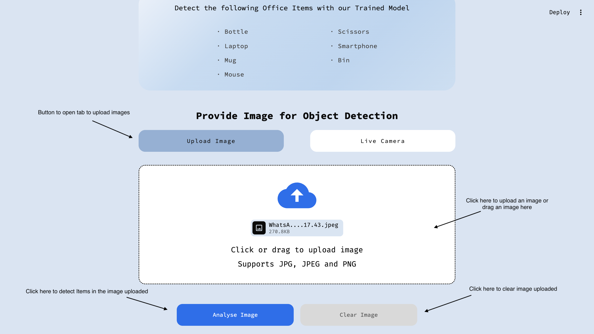

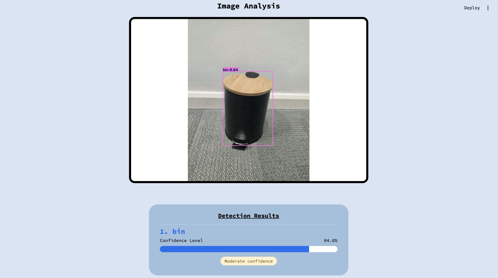

### ii. Live Camera

Click the **Live Camera** Button. Real-time detection is selected by default. Click **START** to begin real-time detection. Detected objects, their bounding boxes and confidence scores will appear on the video frame.

You can click on **SELECT DEVICE** to choose a different camera or video input device.

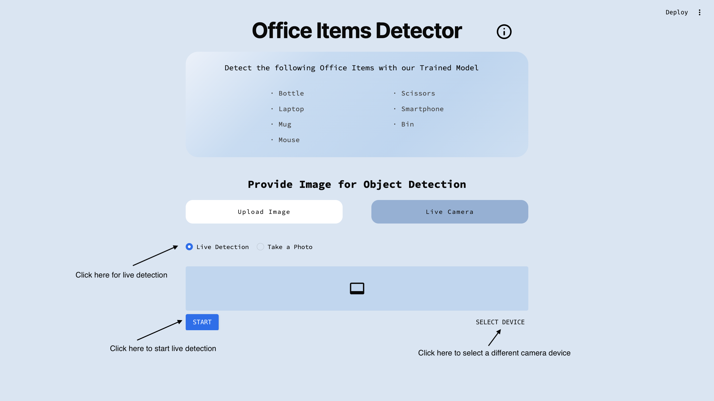

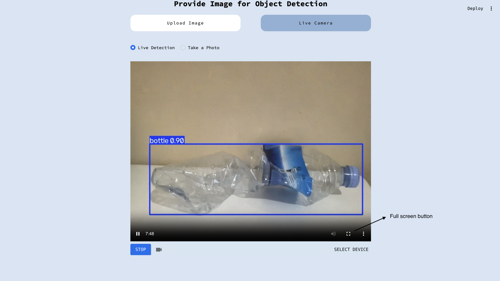

### iii. Capture an Image from the Camera

Select **Take a Photo** to open the camera capture interface. Click **Take Photo** below the camera feed to capture an image. Then, click on **Analyse Image** to run object detection on the captured image.

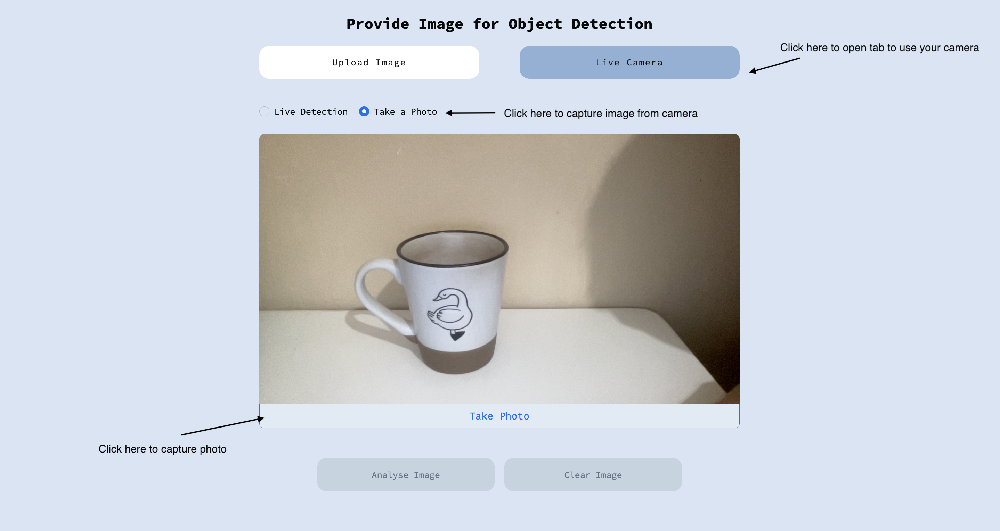
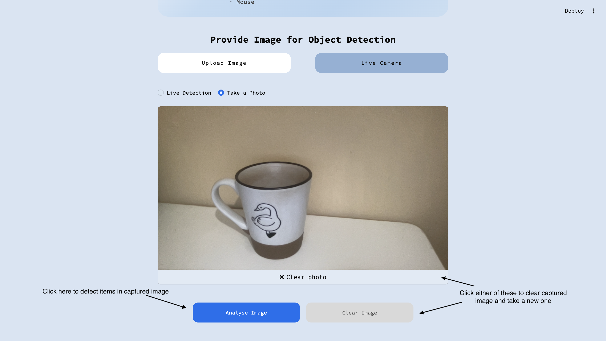
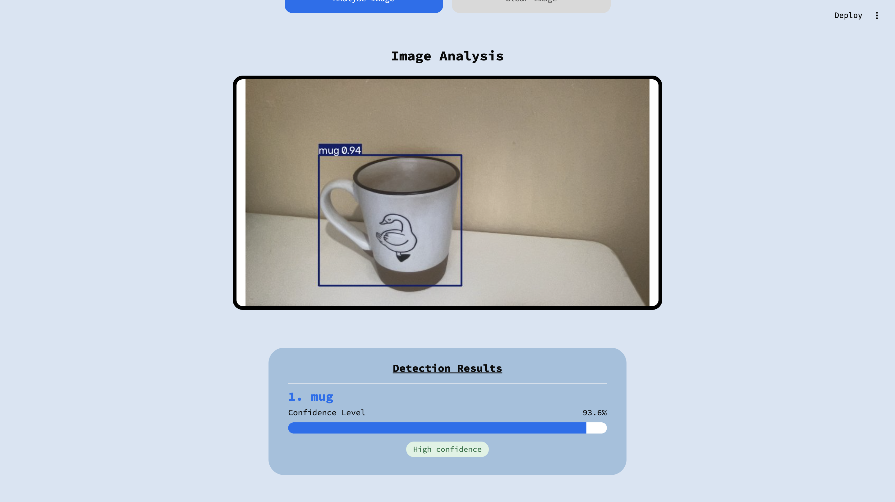

### iv. View Model Performance Metrics

Click the information icon to open a popup displaying details about the model and its performance based on the held-out test data.

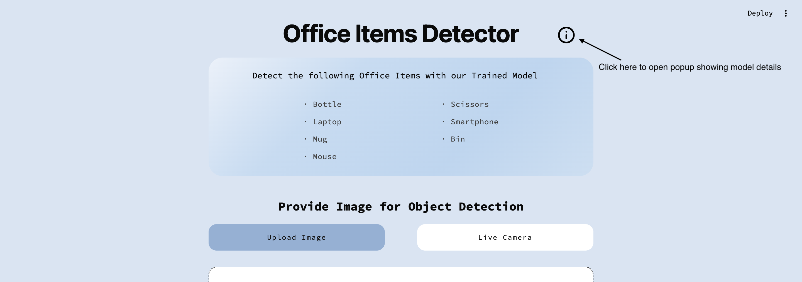
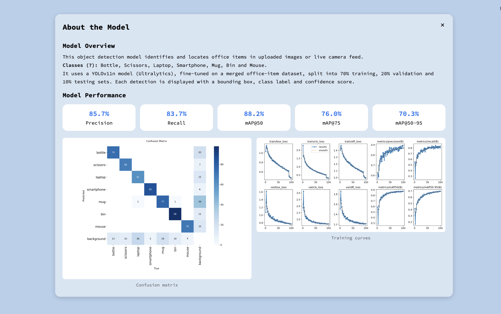

## 8. Expected Outputs

The application displays object detection results based on the input image or camera feed.

The expected outputs include:

- **Detected Objects:** The predicted class labels of detected office items, including bottle, scissors, laptop, smartphone, mug, bin, and mouse.
- **Bounding Boxes:** Rectangular boxes drawn around detected objects to indicate their locations in the image or camera feed.
- **Confidence Scores:** Scores indicating the model's confidence in each detection.

If the model does not detect any object among the 7 classes, no bounding boxes, labels or confidence scores are displayed. Instead, the message "No object detected" is displayed.

## 9. Troubleshooting

The following table lists common issues that may occur when running the application and their possible solutions.

| Issue                                                                          | Possible Solution                                                                                                                                                                                     |
| ------------------------------------------------------------------------------ | ----------------------------------------------------------------------------------------------------------------------------------------------------------------------------------------------------- |
| Installation of the application dependencies using `requirements.txt` fails. | Run `pip install streamlit pillow ultralytics streamlit-webrtc av` in the terminal.                                                                                                                 |
| Missing libraries when running the dataset or model scripts.                   | Run `pip install imagehash numpy pillow ultralytics matplotlib opencv-python` in the terminal.                                                                                                      |
| The application does not start.                                                | Ensure that you are in the project's root directory and that all required dependencies are installed.                                                                                                 |
| streamlit is not recognised as a command.                                      | Install Streamlit by running `pip install streamlit` .                                                                                                                                              |
| The application does not open in the browser automatically.                    | Follow the **local URL** displayed in the terminal.                                                                                                                                             |
| `ModuleNotFoundError`                                                        | Install the missing Python module and ensure that all required dependencies listed in the [Installation](#5-installation) section are installed.                                                       |
| The camera does not work.                                                      | Click on **SELECT DEVICE** to verify that the correct camera is selected. If the issue persists, check your browser's camera permissions and ensure that the camera is connected and available. |
| The YOLO model cannot be found.                                                | Ensure that the trained model file (`best.pt`) exists at the path specified by `MODEL_PATH` in [`ui/config.py`](ui/config.py).                                                                                  |

If the problem persists, check the error messages displayed in the terminal where the application was started.

### Windows: Long Path File Error

When downloading or extracting the `raw` dataset folder on Windows, you may encounter an error indicating that the file name or path is too long.

This is caused by some filenames or folder paths exceeding Window's default path length limitations.

To resolve this, follow these steps:

1. Enable long paths in Windows:

- Press `Win + R`, type `regedit` and press Enter.
- Navigate to `HKEY_LOCAL_MACHINE\SYSTEM\CurrentControlSet\Control\FileSystem`.
- Locate `LongPathsEnabled` and set its value to **1**.
- If the entry does not exist, create a new `DWORD (32-bit) Value` named `LongPathsEnabled` and set it to **1**.

2. Restart your computer for the changes to take effect.
3. Enable long paths in Git by running the following command in the terminal:

```bash
git config --global core.longpaths true
```

4. Extract the `raw` folder again.

## 10. Accuracy & Error Analysis

### 10.1 Evaluation Metrics

The selected baseline YOLO11n model was evaluated on the test set, which consisted of 490 images across 7 classes. It achieved the following results on the test split:

| Metric             | Value |
| ------------------ | ----- |
| mAP50-95           | 0.703 |
| mAP50              | 0.882 |
| mAP75              | 0.760 |
| Mean precision     | 0.857 |
| Mean recall        | 0.837 |
| Macro-Precision    | 0.829 |
| Macro-Recall       | 0.858 |
| Macro-F1           | 0.841 |

The baseline model achieves a strong overall performance with a Macro-F1 of 0.841, which indicates that macro-precision (0.829) and macro-recall (0.858) are reasonably balanced across all 7 classes. Recall being the higher of the two means the model misses relatively few objects at the cost of a few more false positives. The mAP@0.5 of 0.882 shows strong object detection performance when a predicted box only needs to overlap the ground truth by 50%. The lower mAP@0.5:0.95 of 0.703 reflects the stricter bounding box requirement at higher IoU thresholds, where detections are still correct but the boxes fall short on precision.

#### Per-class results

| Class      | Images | Instances | Precision | Recall | mAP@0.5 | mAP@0.5:0.95 |
| ---------- | ------ | --------- | --------- | ------ | ------- | ------------ |
| all        | 490    | 622       | 0.857     | 0.837  | 0.882   | 0.703        |
| bottle     | 70     | 87        | 0.855     | 0.839  | 0.874   | 0.632        |
| scissors   | 70     | 78        | 0.924     | 0.859  | 0.928   | 0.726        |
| laptop     | 70     | 88        | 0.832     | 0.620  | 0.769   | 0.554        |
| smartphone | 70     | 90        | 0.954     | 0.911  | 0.975   | 0.783        |
| mug        | 70     | 96        | 0.672     | 0.781  | 0.784   | 0.704        |
| bin        | 70     | 109       | 0.942     | 0.899  | 0.937   | 0.866        |
| mouse      | 70     | 74        | 0.823     | 0.946  | 0.904   | 0.653        |

The model performs best on smartphones, which achieve the highest F1-score (93.9%), while bins also show strong and balanced precision and recall (both 89.9%). This is most probably because they both have consistent, well-defined shapes. Scissors perform well overall, but the decrease from mAP@0.5 (92.8%) to mAP@0.5:0.95 (72.6%) indicates reduced localisation performance at stricter IoU thresholds. Laptop detection is weakest in terms of recall (69.3%), meaning that many labelled laptop instances are missed. Bottles achieve relatively high recall (85.1%), but their lower precision (78.7%) suggests that some predictions are incorrect. Moreover, their mAP@0.5:0.95 score of 63.2% also indicates room for improvement in localisation. Mugs produce more false-positive predictions, reflected in their low precision (65.3%), despite higher recall (80.2%). Mouse detection shows the opposite tendency, with very high recall (94.6%) but lower precision (82.4%), indicating that most are detected, although some predictions are incorrect.

#### Confusion Matrix

The confusion matrix below provides a more detailed view of the model's predictions on the held-out test set. Correct classifications appear along the diagonal, while off-diagonal entries indicate instances assigned to an incorrect class. The background row represents missed objects, and the background column represents false-positive detections.

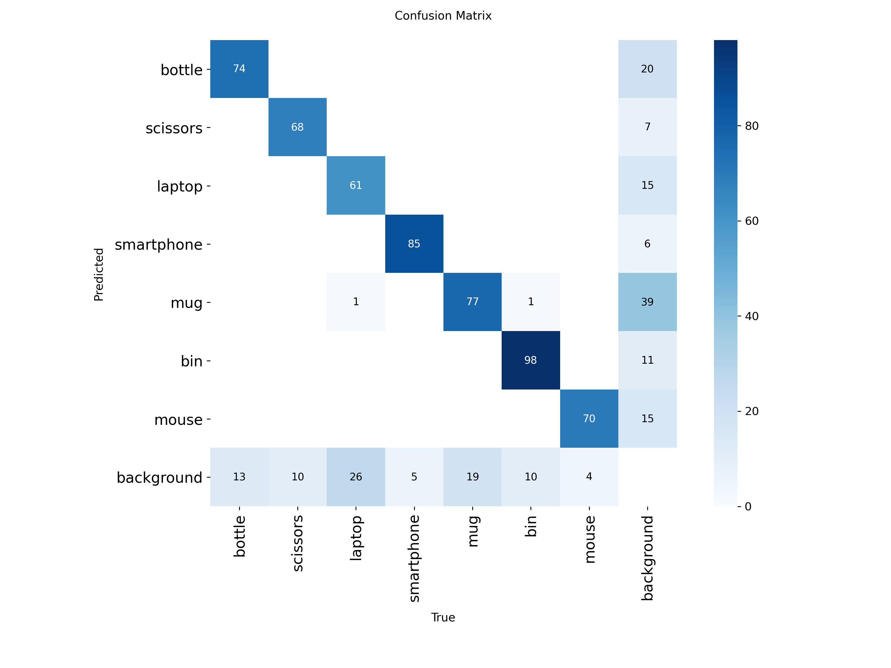

The confusion matrix shows that the model correctly classified 533 of 622 objects, with very few class confusions: only two objects were assigned the wrong class, both predicted as mugs. Most errors involved missed objects (87) or false positives (113), suggesting that the main challenge is detecting objects reliably rather than distinguishing between classes. Laptops were the most frequently missed, accounting for 26 missed objects, while mugs were the most over-predicted, contributing 39 false positives. In contrast, smartphone, bin and mouse had low miss rates, with smartphones also producing the fewest false positives. Overall, the model separates the seven classes well, with a strong diagonal.

#### Robustness Testing

Following the selection of the baseline model, breaking.py was run on a subset of 35 held-out test images to investigate performance under altered image conditions. The script evaluated the original images and transformed versions involving rotation, darkness, blur and size reduction.

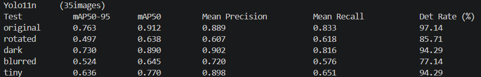

The baseline model maintained a detection rate of 94.29% under dark conditions, with mAP@0.5:0.95 falling by only 4% and precision remaining stable. These results suggest that the model handles reduced lighting well. Under reduced image sizes, the model stayed fairly reliable, with detection rate at 94.29% and precision at 89.8%, though mAP50-95 fell 17%. The main issue was reduced recall, which fell from 83.3% to 65.1%, indicating that the model missed more small objects or placed their boxes less precisely.

Blur had the greatest impact on detection, reducing the detection rate from 97% to 77.14%, lowering recall to 57.6% and decreasing mAP@0.5:0.95 by 31%. This suggests that the model relies on clear edges and textures to recognise objects, making it more likely to miss them when images are blurred. Rotation had the greatest impact on overall detection accuracy, producing the lowest mAP@0.5:0.95 of 0.497, a 35% decrease, and the largest drop in precision. Although the detection rate remained at 85.71%, the model was less accurate in identifying and localising objects.

The robustness results complement the main test-set evaluation by showing how performance changes under specific image transformations. However, as this experiment used only 35 images, the findings offer supporting evidence rather than definitive proof of robustness.

### 10.2 Brief Error Analysis

Although the model achieved correct detections across all seven classes, some weaknesses were observed during testing:

1. **Laptop Detection:** The laptop class had the lowest recall among the seven classes in the reported test results (62.0%). The confusion matrix shows that 26 laptop instances were missed, which may be related to variations in viewing angle and object appearance.
2. **Misclassifications:** The model occasionally classified bins as mugs. This could be due to the shape of open bins resembling the structure of mugs. It also showed difficulties distinguishing between laptops and smartphones at times when viewed from certain angles. The confusion matrix shows overlap between these two classes. While smartphone precision is high (0.954), laptop recall is the lowest of all classes (0.620) This may be due to the similar appearance of closed laptops and smartphones, as well as the presence of screens on both objects. For instance, a smartphone may resemble the screen of a laptop, especially during live camera detection.
3. **Mouse is sensitive to orientation:** Although mouse recall is high, it still produces false positives. During live testing, it was observed that the model's detection performance for mouse also varied with object orientation, especially when viewed at an angle.
4. **False positive detections:** The confusion matrix recorded false positive predictions for multiple classes. Mugs had the highest number of false positives (39), followed by bottles with 20 false positives. These errors suggest that some detected objects or visual features in the image may resemble the target classes.
5. **Missed detections (False Negatives):** The background row indicates missed instances across multiple classes, particularly laptops (26), mugs (19) and bottles (13). Improving the representation of difficult viewpoints and object appearances may help reduce these errors.
6. **Robustness Limitations (Rotation and Blur):** The breaking.py was rerun on the test set for the baseline model and showed that the model struggles most with rotated and blurred images. Mean recall decreased from 83.3% on original images to 61.8% on rotated images and 57.6% on blurred images. This suggests that changes in object orientation and image sharpness can negatively affect detection. Increasing dataset diversity, particularly by including more examples of challenging angles and blurred objects could help improve the detection performance. Additionally, better GPU capabilities would allow for more extensive experimentation, including training with larger datasets and tuning the model using more epochs and iterations.

## 11. Real-World Evaluation

The selected model was also evaluated on a separate collection of 70 independent images across the seven classes [(dataset/own_images/)](dataset/own_images/), with 10 images per class captured using our own devices. This additional experiment assessed the model's ability to generalise to additional captured images of the target objects beyond those included in the official test evaluation.

The model achieved a mAP50 of 95.7%, mAP50-95 of 84.6%, mean precision of 85.3%, and mean recall of 88.3%. These results indicate strong detection performance on this image collection. The difference between mAP50 and mAP50–95 also suggests that localisation performance is less consistent under stricter bounding-box overlap requirements.

| Class      | Precision | Recall | mAP50 | mAP50–95 |
| ---------- | --------- | ------ | ----- | --------- |
| Bottle     | 0.815     | 0.883  | 0.911 | 0.709     |
| Scissors   | 0.886     | 0.909  | 0.981 | 0.855     |
| Laptop     | 0.758     | 0.909  | 0.952 | 0.866     |
| Smartphone | 0.873     | 0.690  | 0.950 | 0.898     |
| Mug        | 0.832     | 0.929  | 0.954 | 0.887     |
| Bin        | 0.896     | 0.861  | 0.962 | 0.800     |
| Mouse      | 0.911     | 1.000  | 0.988 | 0.905     |

At class level, every class exceeded 0.91 mAP50 which indicates consistent performance across the 7 objects. Mouse performed best overall, achieving perfect recall (1.000) with high precision (0.911) and the highest mAP50-95 in the set (0.905), showing high reliability for this class in real conditions although it was sensitive to orientation in live testing. Laptop and mug also performed well, achieving strong recall values of 0.909 and 0.929 respectively. Smartphone had the lowest recall (0.690), despite high precision (0.873) and mAP50–95 (0.898), confirming live observations that smartphones can be missed at certain angles or confused with laptops. Bottle showed comparatively weaker localisation performance, with an mAP50–95 of 0.709, suggesting reduced robustness to variations such as tilted bottles.

Overall, the results point to promising real-world performance, although smartphone detection and bottle localisation remain areas for improvement. However, since the collection is relatively small, with only 10 images per class, these results should be interpreted as an additional real-world evaluation rather than proof of generalisation across different environments.

## 12. References

**Model evaluation:**

sarahsftri. (2024) *YOLOv8 classification metrics #9946*. Available at: https://github.com/ultralytics/ultralytics/issues/9946#issuecomment-2132207985 (Accessed: 27 October 2026).

Ultralytics (n.d.) *Model Validation with Ultralytics YOLO*. Available at: https://docs.ultralytics.com/modes/val (Accessed: 27 October 2026).

**Convert YOLO bounding box coordinates:**

HansHirse. (2020) *How to convert Yolo format bounding box coordinates into OpenCV format*. Available at: https://stackoverflow.com/questions/64096953/how-to-convert-yolo-format-bounding-box-coordinates-into-opencv-format (Accessed: 20 October 2026).

**Model Hyperparameter Tuning:**

glenn-jocher. (2026) *tuner.py*. Available at: https://github.com/ultralytics/ultralytics/blob/v8.4.190/ultralytics/engine/tuner.py (Accessed: 26 October 2026).

**UI:**

Streamlit (n.d.) *Theming overview*. Available at: https://docs.streamlit.io/develop/concepts/configuration/theming (Accessed: 17 October 2026).