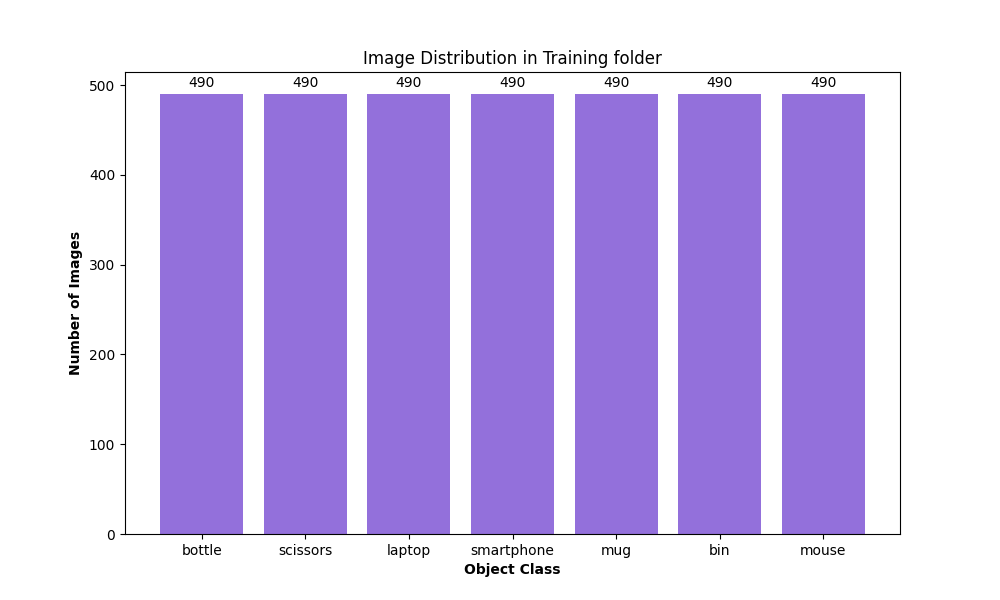

# Office Object Detection Dataset
## 1. Overview
This dataset was developed for **office object detection** to support an autonomous indoor office robot. 
It is designed to train and evaluate a **YOLO11n** object detection model capable of identifying common office items to help the robot locate, monitor, retrieve and organise objects within a designated area.

## 2. Dataset Information
- **Task**: Office Object Detection
- **Model**: YOLO11n (Ultralytics)
- **Number of Classes**: 7
- **Annotation Format**: YOLO bounding-box format
- **Dataset Splits**: Train, Valid, and Test

## 3. Classes
The dataset contains seven object classes. The classes and their corresponding IDs as defined in the data.yaml configuration file, are listed below.

| Class ID | Object    |
|--------  | -------   |
| 0        | bottle    |
| 1        | scissors  |
| 2        | laptop    |
| 3        | smartphone|
| 4        | mug       |
| 5        | bin       |
| 6        | mouse     |

## 4. Sources
The dataset was assembled by combining images from multiple other object detection datasets, as shown in the table below.

| Object  | Source  |
| ------- | ------- |
| bottle  | https://universe.roboflow.com/aaaa-lg0ki/bottle-detection-ak5ic/dataset/1 <br> https://universe.roboflow.com/monikaprojects/cup-bottle-tv28f/dataset/4 |
| scissors| https://universe.roboflow.com/dinuo-bob/scissors-oiawb/dataset/6 <br> https://universe.roboflow.com/proyecto1-cdldz/scissors-vjcxk-gf6el/dataset/2 <br> https://universe.roboflow.com/research-joczo/scissors-laii6/dataset/1  <br> https://universe.roboflow.com/database-nisa/gunting-3/dataset/2   |
| laptop  | https://universe.roboflow.com/megane-coret/laptop-8napa-ncc2i/dataset/2 (Original: https://universe.roboflow.com/visionassistobstaclesone/laptop-8napa) <br> https://universe.roboflow.com/megane-coret/laptop-ameuf-ur9nt/dataset/1 (Original: https://universe.roboflow.com/my-work-gwakh/laptop-ameuf)<br> https://universe.roboflow.com/luthfilproject/laptop-sba9l/dataset/3 <br> https://universe.roboflow.com/harunurrashid/laptop-dy332/dataset/1 |
| smartphone| https://universe.roboflow.com/objek-dalam-7-ayunda/smartphone-xydru/dataset/1 <br> https://universe.roboflow.com/senior-project-final-datasets/mobile-phone-teosq/dataset/1 |
| mug   | https://universe.roboflow.com/husnain-xealh/mug-openimages/dataset/1 |
| bin     | https://universe.roboflow.com/2-olter/office-trashcan/dataset/2  |
| mouse   | https://universe.roboflow.com/5-3rmid/office-mouse-p1otz/dataset/1 |

## 5. Raw Dataset Setup
The raw datasets are stored separately in a folder named `raw` on **Google Drive** and are not included in the GitHub repository. 

The `raw` folder must be downloaded if you intend to run `preprocessing.py`. However, it is not required to run the object detection model.

Follow these steps to download the raw datasets:
1. Download the `raw` folder from Google Drive at [https://drive.google.com/drive/folders/1Mv8jGZ5AU8regNH-kUswxuPGWikgAMwI?usp=sharing](https://drive.google.com/drive/folders/1Mv8jGZ5AU8regNH-kUswxuPGWikgAMwI?usp=sharing).
2. Extract the downloaded folder and ensure that the resulting folder is named `raw`.
3. Place the `raw` folder inside the `dataset` directory.

**Windows Users**: If you encounter a file path length error when extracting the folder `raw`, refer to the [Troubleshooting](../README.md#9-troubleshooting) in the project README.

**Note**: The source datasets in the `raw` folder have been subject to minor structural modifications compared to their original downloaded versions. These include folder renaming and reorganisation to accommodate the dataset merging and preprocessing workflow.

## 6. Dataset Preprocessing

### 6.1. Steps
The following preprocessing steps were applied to the source datasets obtained from publicly available datasets and stored in the `raw` folder to prepare the final merged dataset for training, available at [dataset/processed](../dataset/processed):

1. **Class ID Remapping:**

Class IDs were standardised to match the class IDs defined in the data.yaml. Annotations belonging to unused classes were discarded.

2. **Image and Label Validation:**

Image file extensions were checked, and empty or invalid label files were discarded. Labels were validated to ensure they contained the required five values per bounding box (class_id, x_center, y_center, width and height), with coordinates and dimensions in the range 0 to 1.

3. **Image Duplicate Detection:**

Perceptual hashing was used to identify identical or near-duplicate images, including mirrored-image comparisons. Detected  duplicates were removed to reduce risk of data leakage between dataset splits and improve the diversity of the dataset.

4. **Valid Image-Label Pair Extraction:**

Images were matched with their corresponding annotation files, and valid image-label pairs were retained for dataset preparation.

5. **Dataset splitting:**

Existing dataset splits were preserved to help prevent data leakage, while images from sources without predefined splits were randomly divided into training, validation and test sets. 700 images were selected per object class, with 70% retained for training, 20% for validation and 10% for testing.

### 6.2 Libraries
The following libraries were used:
- **imagehash**: Used to generate perceptual hashes to help identify potential duplicate images.
- **pathlib**: Used to handle file and directory path
- **shutil**: Used for file and directory operations.
- **numpy**: Used for numerical and array operations.
- **Pillow**: Used to load, convert and process images.
- **random**: Used to randomly select dataset image-label pairs.

## 7. Dataset Splits

The target dataset split proportions per class were:
- Training : 70%
- Validation: 20%
- Testing: 10%

The training set is used to train the model, while the validation set is used to monitor performance and support model tuning. The test set is reserved for final evaluation to assess how well the model generalises unseen data.

The **70/20/10** split was selected based on a commonly adopted approach to dividing datasets in machine learning. With a target of 700 images per class, allocating 70% (490 images) to training provides the model with a larger set of examples from which to learn object features. The 20% (140 images) validation set provides sufficient data to understand how well the model is performing on images not used for training and guide hyperparameter tuning. The remaining 10% (70 images) is reserved for final testing, providing an independent set of images to assess the final model's performance in production. (Solawetz, J, 2026)


### 7.1 Image Distribution by Class

The dataset contains **4,900 images** across the training, validation and test sets: **3,430** in the Training Set, **980** in the Validation Set and **490** in the Testing Set.

The charts below represent the number of images per class in each set.




## 8. Dataset Folder Structure

```text
dataset/
├── processed/
│   ├── test/
│   │   ├── images/
│   │   └── labels/
│   │ 
│   ├── train/
│   │   ├── images/
│   │   └── labels/
│   │ 
│   └── valid/
│       ├── images/
│       └── labels/
│
├── data.yaml
│
├── DATASET_CARD.md
│
└── own_images/
```

- **processed/**: Contains the final merged dataset used by the model, organised into training, validation and testing sets.
- **images/**: Contains the images for each dataset split.
- **labels/**: Contains the corresponding YOLO annotation `.txt` files for the images in each split.
- **data.yaml**: Configuration file that defines the dataset path, the locations of the images for the training, validation and testing, and the class names.
- **own_images/**: Contains an additional independent set of images used to evaluate the model's performance on real-world images.

## 9. Model and Dataset Design Choices

### 9.1 Model Selection

YOLO11n was selected for its lightweight architecture and relatively low computational requirements, making it a suitable object detection model candidate for deployment on the CPU of a Raspberry Pi for an indoor office robot. Its smaller model size offers a balance between detection performance and computational efficiency.

YOLO11 incorporates architectural components such as C3k2 (Cross Stage Partial with kernel size 2) blocks, SPPF (Spatial Pyramid Pooling - Fast), and C2PSA (Convolutional block with Parallel Spatial Attention). These components contribute to improved feature extraction and model accuracy for real-time detection. In particular, the C3k2 replaces the C2f blocks used in previous YOLO models with a more efficient design to help reduce computational requirements and improve processing speed. (Gallagher, J., 2024)

According to Ultralytics (2026), YOLO11 offers improvements in accuracy, speed, and efficiency compared to previous versions. Its refined backbone and neck architecture enhance feature extraction for more precise object detection, while its optimised design aims to improve 
processing speeds without compromising detection accuracy and performance.

The YOLO11 training pipeline also supports data augmentation techniques, including HSV adjustments, flipping and scaling. These transformations introduce variation into the training images, which can help the model generalise to different object appearances and image conditions.

The **nano** variant is the smallest and fastest version of YOLO11 (Ultralytics, 2026). It was selected to reduce computational demands while retaining the object detection capabilities needed for the project and providing less latency.


### 9.2 Source Selection and Dataset Design

The selected datasets were chosen because they provided suitable images for the seven target classes and offered variation in terms of object appearance, backgrounds and image conditions. Where necessary, images from multiple datasets were combined to increase the diversity and quantity available for certain classes.

A target of 700 images was selected per class to keep the dataset manageable while providing a substantial number of training examples for the model to learn relevant object features. 

Furthermore, transfer learning was performed by using a pre-trained model with weights learned from a larger dataset and fine-tuning it on the custom dataset. This provided a starting point based on previously learned features and patterns, reducing the need to learn all features from scratch. (GeeksForGeeks, 2025)

## 10. Additional Evaluation Images
In addition to the main dataset, a separate collection of independently captured images ([`dataset/own_images/`](../dataset/own_images/)) was used for supplementary evaluation. This collection consists only of a test set and was not included in the training, validation or test splits. It contains 10 images per class and was annotated using Roboflow. The images were captured by our team and used to further assess the model's object detection performance on additional real-world images.

## 11. Dataset Attributions and Licensing
| Object  | Author  | Year    | License  |
| ------- | ------- | ------- | -------  |
| bottle  |   aaaa      |   2024      |     [CC BY 4.0](https://creativecommons.org/licenses/by/4.0/)     |
| bottle  |   MonikaProjects      |   2024      |     [CC BY 4.0](https://creativecommons.org/licenses/by/4.0/)     |
| scissors|  dinuo Bob        |    2024     |      [CC BY 4.0](https://creativecommons.org/licenses/by/4.0/)      |
| scissors|  proyecto1-cdldz        |    2025     |      [CC BY 4.0](https://creativecommons.org/licenses/by/4.0/)      |
| scissors|  research        |    2024     |      [CC BY 4.0](https://creativecommons.org/licenses/by/4.0/)      |
| scissors|  Database Nisa        |    2024     |      [CC BY 4.0](https://creativecommons.org/licenses/by/4.0/)      |
| laptop  |    VisionAssistObstaclesOne     |     2025    |    [CC BY 4.0](https://creativecommons.org/licenses/by/4.0/)       |
| laptop  |    my work     |     2025    |    [CC BY 4.0](https://creativecommons.org/licenses/by/4.0/)       |
| laptop  |    LuthfilProject     |     2025    |    [CC BY 4.0](https://creativecommons.org/licenses/by/4.0/)       |
| laptop  |    harunurrashid     |     2022    |    [CC BY 4.0](https://creativecommons.org/licenses/by/4.0/)       |
| smartphone |  Objek Dalam 7 Ayunda       |    2023     |   [CC BY 4.](https://creativecommons.org/licenses/by/4.0/)       |
| smartphone |  Senior project final datasets       |    2023     |   [Public Domain](https://creativecommons.org/publicdomain/zero/1.0/)       |
| mug |    husnain     |    2025     | [MIT](https://choosealicense.com/licenses/mit/)          |
| bin |   2      |  2024       |  Not Specified         |
| mouse   |  5       |    2024    |   Not Specified     |


## 12. References

Gallagher, J. (2024) *What Is YOLOv11? An Introduction*. Available at: https://roboflow.com/blog/what-is-yolo11 (Accessed: 31 October 2026).

GeeksForGeeks (2025) *Explain the concept of transfer learning and its application in computer vision*. Available at: https://www.geeksforgeeks.org/computer-vision/explain-the-concept-of-transfer-learning-and-its-application-in-computer-vision/ (Accessed: 28 October 2026).

Solawetz, J. (2026) *Train, Validation, Test Split for Machine Learning*. Available at: https://roboflow.com/blog/train-test-split (Accessed: 27 October 2026).

Ultralytics (2026) *Ultralytics YOLO11*. Available at: https://docs.ultralytics.com/models/yolo11 (Accessed: 20 October 2026).